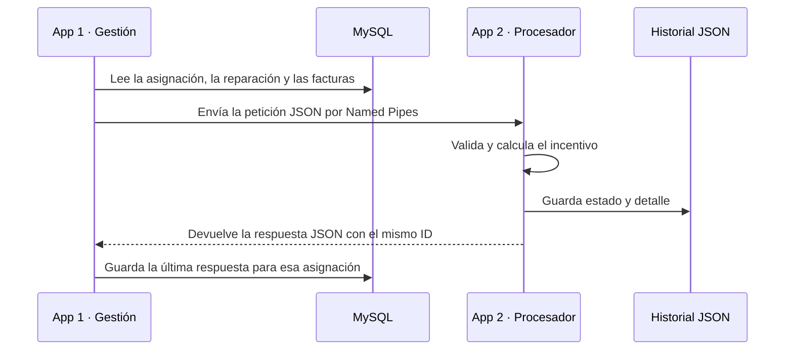

# Taller mecánico

**Desarrollo de Interfaces y Programación de Servicios y Procesos · 2.º DAM**  
**Integrantes** Diego González y David Cordón

## Objetivo

Gestionar los clientes, vehículos, mecánicos, reparaciones y facturas de un taller. La aplicación de gestión consulta MySQL y solicita a un segundo programa que calcule el incentivo de un mecánico por una reparación.

## Aplicaciones

| Aplicación | Qué hace |
|---|---|
| `Proyecto_DI_PSP1` | Gestiona las tablas del taller en WPF. Valida altas y cambios, envía solicitudes y guarda la última respuesta de cada asignación en MySQL. |
| `Proyecto_DI_PSP2` | Escucha peticiones en un hilo del ThreadPool, valida los datos y calcula el incentivo. Actualiza el historial WPF mediante `Dispatcher` y lo conserva en JSON. |

**Figura 1.** El identificador de la petición permite relacionar la respuesta guardada en MySQL con la entrada en el historial.

**Figura 2.** El diagrama inicial muestra las seis tablas del taller. El script final añade `Incentivos`, que depende de la clave compuesta de `Reparacion_Mecanico`.

## Regla del incentivo

El cálculo se realiza por cada pareja de reparación y mecánico. Si la reparación está finalizada y tiene facturas que constan todas como pagadas, el incentivo es **horas trabajadas × coste por hora × 10 %**. Se redondea a dos decimales. Si la reparación no cumple los estados, la respuesta es «Sin incentivo» y el importe es cero. Las horas o costes inválidos dan «Error de validación».

El ejemplo SQL tiene una asignación de 2,50 horas a 30 €/hora. Su mano de obra asciende a 75 € y el incentivo es de **7,50 €**. Cada mecánico de la misma reparación se calcula con sus propias horas y coste.

## Proceso de desarrollo

| Orden | Trabajo |
|---|---|
| 1 | Se definieron las relaciones entre clientes, vehículos, reparaciones, mecánicos y facturas. Se redactó un documento inicial sobre Named Pipes y se prepararon ejemplos JSON. |
| 2 | Se organizaron dos proyectos WPF en la solución de Visual Studio. Se completó el SQL con datos ficticios y se añadió la tabla de resultados. |
| 3 | Se añadieron entidades y `TallerContext` para leer y guardar con Entity Framework Core y Pomelo. El ViewModel usa el registro seleccionado para cargar una copia en el formulario. Los comandos validan y guardan los cambios. |
| 4 | Se implementó el cliente y el servidor Named Pipes, los mensajes JSON, el cálculo y el historial. El servidor escucha en segundo plano y entrega cada entrada a la ventana con `Dispatcher`. |
| 5 | Se probaron las ventanas con una instancia temporal de MySQL y los casos con incentivo, sin incentivo y con datos inválidos. |

### Reparto del trabajo

| Integrante | Aportación |
|---|---|
| David Cordón | Base de datos del taller. |
| Diego González y David Cordón | Documento general del proyecto. |
| Diego González | Documento de Named Pipes y organización del proyecto. |

La implementación, las pruebas y esta memoria se prepararon con ayuda de Codex.

## Dificultades y soluciones

- **Atribuir el incentivo cuando participan varios mecánicos.** Las horas y el coste se toman de la asignación de cada persona. Así cada cálculo usa su propia mano de obra.
- **Mantener la ventana del procesador disponible.** La escucha arranca con `Task.Run` y permite cancelar la espera al cerrar. La colección del historial se actualiza en el hilo de la ventana con `Dispatcher`.
- **Leer el identificador guardado en MySQL.** Durante la primera prueba el conector interpretó el campo `CHAR(36)` como un `Guid`. La entidad ahora usa el mismo tipo que la petición, lo que permite leer tanto el resultado guardado como los nuevos.
- **Mostrar los errores junto al resultado.** El estado describe cómo terminó la petición y el detalle indica la causa. El historial incluye una columna separada para la excepción técnica si la hay.

## Ejecutar la demostración

1. En MySQL 8, ejecuta [tablas.sql](tablas.sql) una vez sobre una instalación que aún no tenga las tablas de `taller_di_psp`. Crea el esquema y carga los registros ficticios. Usa una cuenta con permisos sobre ese esquema.
2. Abre [Proyecto_DI_PSP.slnx](../Proyecto_DI_PSP.slnx) en Visual Studio Community y compila la solución. Los dos proyectos usan .NET 9.
3. Inicia primero `Proyecto_DI_PSP2`. Luego inicia `Proyecto_DI_PSP1` y pulsa **Conectar** con los datos de tu MySQL. La contraseña se introduce en la ventana.
4. Abre **Asignaciones**, elige la reparación 15 y el mecánico 1, y pulsa **Calcular incentivo**. Deben aparecer 7,50 € en **Incentivos** y una entrada «Calculada» en la App 2. Repite con la reparación 16 y el mecánico 2 para ver «Sin incentivo».
5. Cierra y abre las dos aplicaciones. Reconecta la App 1 a MySQL para ver sus resultados. La App 2 carga su historial de `%LOCALAPPDATA%\Proyecto_DI_PSP\registro.json`.

Los archivos de ejemplo están en [json](../json). El documento previo sobre Named Pipes está en [DI-PSP_NamedPipes.pdf](DI-PSP_NamedPipes.pdf). Su propuesta de facturación por período corresponde a la fase de diseño anterior a la regla por reparación que se usa aquí.

## Resultado de las pruebas

| Caso | Resultado observado |
|---|---|
| Guardar un cliente sin nombre | La aplicación muestra «Escribe el nombre» y no guarda. |
| Crear y editar un cliente de prueba | Los cambios aparecen en la cuadrícula y se conservan al volver a conectar. |
| Borrar en cascada desde MySQL, dentro de una transacción de prueba | Desaparecen los registros dependientes. La transacción se revierte después de comprobarlo. |
| Solicitar el incentivo de la reparación 15, mecánico 1 | La App 1 recibe y guarda 7,50 €. La App 2 registra «Calculada». |
| Solicitar el incentivo de la reparación 16, mecánico 2 | La App 1 recibe y guarda 0 €. La App 2 registra «Sin incentivo». |
| Enviar una petición de prueba con horas negativas | La App 2 devuelve «Error de validación» con el ID original. |
| Volver a abrir el procesador | La cuadrícula recupera los tres estados del archivo JSON. |
